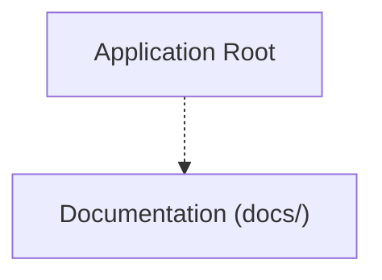

<!-- BRIEF: COMMIT=395eb044 HASH=9b3bf91f DATE=2026-11-02T19:19:18.263Z -->
# Project Brief: MacLink
- **Commit**: `395eb044` | **Updated**: 2026-11-02T19:19:18.263Z | **Files Tracked**: 91

## Overview
**Your Android phone and your Mac, working seamlessly as one.**

## Tech Stack
- Generic / Stack undetected

## Project Map (Directory Tree)
```text
.
├── .agent/ (5 files)
├── AndroidCompanion/ (16 files)
│   └── app/ (16 files)
├── MacCompanion/ (19 files)
│   ├── Sources/ (14 files)
│   └── Tests/ (3 files)
├── assets/ (18 files)
│   ├── brand/ (8 files)
│   ├── fonts/ (8 files)
│   └── screenshots/ (2 files)
├── docs/ (26 files)
│   ├── calls/ (4 files)
│   └── diagrams/ (9 files)
├── shared/ (1 file)
│   └── protocol/ (1 file)
├── .DS_Store
├── AGENTS.md
├── README.md
├── aqtinstall.log
├── install.sh
└── nectarlink
```

## Architecture Chart


## Likely Entry Points
- None identified

## Key Commands
- No build/test scripts found

## Project Rules (AGENTS.md)
# Workspace Rules

## Build Rule
- **Only build the app when explicitly told by the user. If not mentioned, do not build the app.**
- Verification may use fast checks (like `cargo check` or linting), but do not run full packaging, release builds, or build scripts (`build-all.sh`, `macdeployqt`, etc.) unless the user explicitly requests a build.
