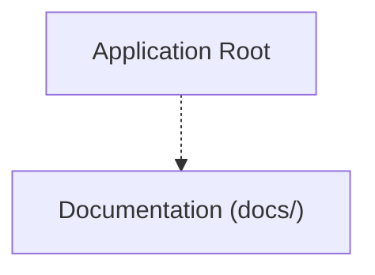

<!-- BRIEF: COMMIT=ea7e1506 HASH=f4dae7c1 DATE=2026-11-01T15:06:36.098Z -->
# Project Brief: nectarlink
- **Commit**: `ea7e1506` | **Updated**: 2026-11-01T15:06:36.098Z | **Files Tracked**: 606

## Overview
**Your Android phone and your Mac, working seamlessly as one.**

## Tech Stack
- Rust (Cargo.toml)

## Project Map (Directory Tree)
```text
.
├── .agent/ (6 files)
├── .cargo/ (1 file)
├── .github/ (9 files)
│   ├── ISSUE_TEMPLATE/ (3 files)
│   ├── scripts/ (1 file)
│   └── workflows/ (2 files)
├── LICENSES/ (5 files)
├── android/ (182 files)
│   ├── app/ (173 files)
│   └── gradle/ (3 files)
├── assets/ (16 files)
│   ├── brand/ (8 files)
│   └── fonts/ (8 files)
├── core/ (57 files)
│   ├── maclink-adb/ (2 files)
│   ├── maclink-cli/ (2 files)
│   ├── maclink-core/ (40 files)
│   ├── maclink-ffi/ (4 files)
│   └── maclink-protocol/ (9 files)
├── desktop/ (195 files)
│   ├── app/ (189 files)
│   ├── packaging/ (1 file)
│   └── vcam/ (5 files)
├── docs/ (118 files)
│   ├── adr/ (9 files)
│   ├── architecture/ (2 files)
│   ├── design/ (6 files)
│   ├── foundations/ (1 file)
│   ├── guide/ (52 files)
│   ├── protocol/ (19 files)
│   ├── research/ (1 file)
│   ├── screenshots/ (14 files)
│   └── technical/ (9 files)
├── tools/ (4 files)
│   └── xtask/ (4 files)
├── .editorconfig
├── .gitattributes
├── .gitignore
├── CHANGELOG.md
├── Cargo.lock
├── Cargo.toml
├── LICENSE
├── README.md
├── SECURITY.md
├── TRADEMARKS.md
├── deny.toml
├── rust-toolchain.toml
└── rustfmt.toml
```

## Architecture Chart


## Likely Entry Points
- `core/maclink-cli/src/main.rs`
- `desktop/app/qml/App.qml`
- `desktop/app/src/bridge/app.rs`
- `desktop/app/src/main.rs`
- `docs/design/mockups/index.html`
- `docs/design/themes/index.html`
- `tools/xtask/src/main.rs`

## Key Commands
- No build/test scripts found
