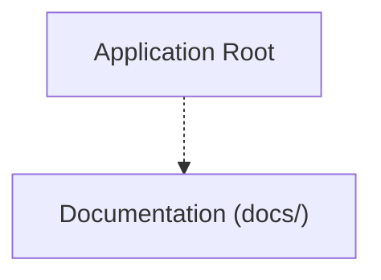

# Project Map & Architecture: MacLink
Generated on: 2026-11-02T19:19:18.265Z | Total Tracked Files: 91

## Architecture Flowchart


## Directory Structure Map
```text
.
├── .agent/ (5 files)
├── AndroidCompanion/ (16 files)
│   └── app/ (16 files)
├── MacCompanion/ (19 files)
│   ├── Sources/ (14 files)
│   └── Tests/ (3 files)
├── assets/ (18 files)
│   ├── brand/ (8 files)
│   ├── fonts/ (8 files)
│   └── screenshots/ (2 files)
├── docs/ (26 files)
│   ├── calls/ (4 files)
│   └── diagrams/ (9 files)
├── shared/ (1 file)
│   └── protocol/ (1 file)
├── .DS_Store
├── AGENTS.md
├── README.md
├── aqtinstall.log
├── install.sh
└── nectarlink
```
