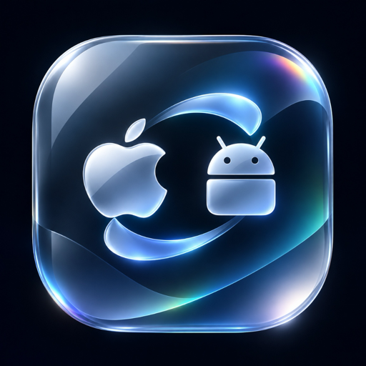

<div align="center">



# MacLink

**Your Android phone and your Mac, working seamlessly as one.**

Notifications, messages, calls, bidirectional clipboard, high-speed file transfers, photo access, and low-latency screen mirroring between Android and macOS.
Fast, local-first, end-to-end encrypted, without third-party cloud servers or accounts.

[-black.svg)](desktop/packaging/macos/build-app.sh)
[-green.svg)](android/)
[](core/maclink-core/src/session.rs)
[](LICENSE)
[](LICENSE)

</div>

---

## Overview

**MacLink** delivers a deep, native integration between Android devices and macOS computers. Connected directly over local Wi-Fi or USB via authenticated peer-to-peer QUIC tunnels, your data remains completely private, secure, and on-device at all times.

### Key Capabilities

- **Apple Liquid Glass Interface**: Designed from the ground up with a fluid, translucent glass aesthetic inspired by modern optical physics. Features Snell refraction, chromatic dispersion along edges, dual-axis specular highlights, and natural spring motion in both **Obsidian Dark** and **Crystal Light** modes.
- **Mandatory Package Verification**: Handshakes enforce strict application package validation (`in.maclink.srv`). Connection attempts from unauthorized or mismatched clients are rejected before establishing a session.
- **Real-Time Notification Mirroring**: Stream notifications directly to macOS with interactive quick-reply actions, dismiss actions, and one-click OTP verification code copying.
- **Unified Messaging**: View conversations, SMS, MMS, and chat threads in a unified desktop interface with full reply and notification support.
- **Phone Calls & Audio Management**: Receive caller ID alerts, answer or decline incoming calls from your Mac, and dial contacts directly through your phone.
- **Encrypted Bidirectional Clipboard**: Seamlessly copy text or images on Mac and paste on Android, and vice-versa. Includes automatic protection and filtering for passwords and sensitive credentials.
- **High-Speed File & Folder Sharing**: Drag and drop documents, photos, and directories over local Wi-Fi with integrity hashing and automatic transfer resume.
- **Phone Screen Mirroring & Remote Input**: Mirror your Android display at up to 60 FPS using hardware-accelerated H.264 video, with keyboard, mouse, and multi-touch support.
- **Media Controls & Handoff**: Control music and video playback across devices, and pass open browser URLs and map locations between devices instantly.

---

## Architecture

```text
  Android App (Kotlin, Jetpack Compose)          Mac App (Qt 6, C++, Rust)
  Package: in.maclink.srv                        Package: in.maclink.srv
               │ UniFFI                                    │ cxx-qt
               ▼                                           ▼
      ┌──────────────────┐       QUIC (iroh)      ┌──────────────────┐
      │   maclink-core   │◄──────────────────────►│   maclink-core   │
      │ pairing, crypto, │   TLS 1.3 encrypted    │ pairing, crypto, │
      │ sessions, storage│   ALPN: maclink/0      │ sessions, storage│
      └──────────────────┘                        └──────────────────┘
```

- **Shared Rust Core (`core/`)**: Cross-platform engine managing Ed25519 cryptography, TLS 1.3 QUIC transports, SAS visual verification, peer pairing, and state storage.
- **Native Mac Desktop App (`desktop/`)**: Built for macOS using Qt 6 Quick with Apple Liquid Glass QML shaders, native window borders, menu bar integration, and Apple Silicon optimizations.
- **Native Android App (`android/`)**: Built in Kotlin and Jetpack Compose featuring custom AGSL Liquid Glass runtime shaders with chromatic dispersion and system services integration.
- **Command-Line Interface (`maclink`)**: Comprehensive CLI utility for terminal workflows, scripting, and headless daemon operations.

---

## Building from Source

### Prerequisites

- **macOS Host**: macOS 14 (Sonoma) or macOS 15+ (Sequoia), Apple Silicon (M1/M2/M3/M4) or Intel
- **Rust Toolchain**: `rustup` with Rust 1.80+ (`rust-toolchain.toml`)
- **Qt 6**: Qt 6.8+ SDK (Core, Quick, Qml, Tools)
- **Android SDK & NDK**: Platform 34/35/37, NDK `30.0.16248370`, JDK 21

### 1. Build MacLink for macOS

To compile the native Apple Silicon release binaries and bundle the standalone `MacLink.app`:

```bash
# Build the native CLI executable
cargo build --release --bin maclink

# Build the desktop GUI executable
cargo build --release --bin maclink-desktop

# Package MacLink.app and distribution zip
./desktop/packaging/macos/build-app.sh
```

The resulting application bundle `MacLink.app` is placed in `dist/`.

### 2. Build MacLink for Android

To compile the shared Rust FFI library via `cargo-ndk` and assemble the Android APK:

```bash
# Install Android target
rustup target add aarch64-linux-android
cargo install cargo-ndk

# Assemble the Android APK
cd android
./gradlew assembleDebug -Pmaclink.abis=arm64-v8a
```

The compiled APK will be generated at `android/app/build/outputs/apk/debug/app-debug.apk`.

### 3. Run Test Suites

To verify cryptographic handshakes, package verification gates, and protocol serialization:

```bash
cargo test -p maclink-protocol -p maclink-core -p maclink-cli
```

---

## Security & Privacy

- **Zero-Cloud Architecture**: All pairing tokens, media streams, and clipboard payloads travel directly peer-to-peer over your local network. No external servers or telemetry are involved.
- **Cryptographic Mutual Authentication**: Every device generates a persistent Ed25519 identity key. Pairing requires out-of-band QR code scanning or a 6-digit Short Authentication String (SAS) derived from TLS keying material.
- **App Authenticity Gate**: Handshakes require and enforce matching `in.maclink.srv` application signatures and package identifiers before establishing any connection.
- **Encrypted Local Storage**: Cached tokens, paired peer endpoints, and transfer metadata are stored in AES-GCM / XChaCha20 encrypted local SQLite databases protected by the OS keychain/keystore.
- **Granular Controls**: Every capability—including clipboard sync, cameras, microphones, and screen mirroring—can be toggled and audited individually per device.

---

## License

- Applications & CLI: [GPL-3.0-or-later](LICENSES/GPL-3.0-or-later.txt)
- Core Engine & Protocol: [MPL-2.0](LICENSES/MPL-2.0.txt)
- Typography: [SIL Open Font License 1.1](assets/fonts/OFL-SpaceMono.txt)
